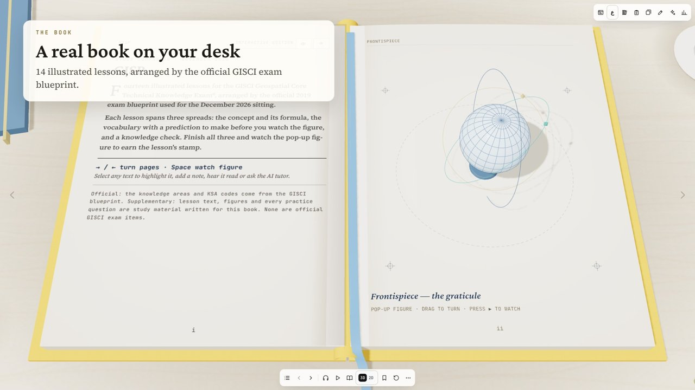
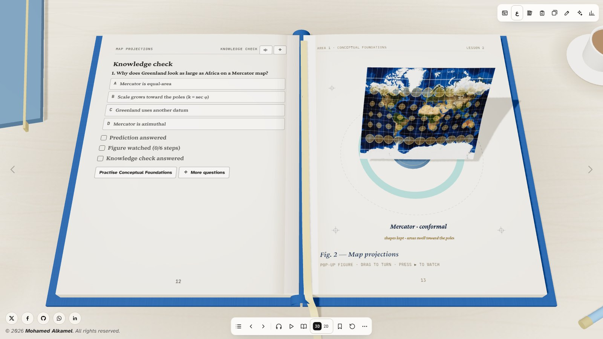
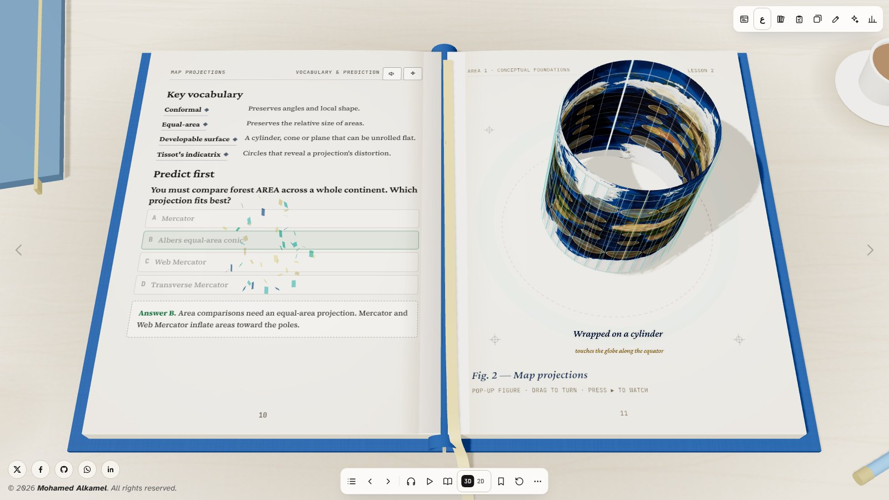
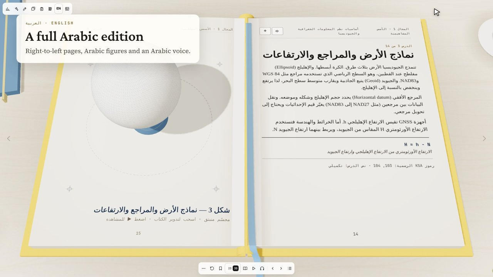

# GISP Study Guide: Interactive 3D Study Book

An interactive study book for the **GISCI Geospatial Core Technical Knowledge Exam (GISP)**. It looks like a real hardcover book on a desk: it starts closed under a blue cloth cover with a gold title, and you click the cover to open it. Going back from the first page closes it again. The left page holds the lesson. The right page holds a pop-up 3D figure that explains the concept step by step.



## What's inside

| | |
|---|---|
| **14 illustrated lessons** | Arranged by the official GISCI exam blueprint: coordinates, projections, datums, topology, data quality, cartography, GNSS, remote sensing, raster analysis, overlay, spatial statistics, geodatabases, web GIS architecture, and project management |
| **Pop-up 3D figures** | One per lesson, built with three.js. Step through them, play them as a demo, and drag to rotate |
| **Learning loop** | Predict, then lift the flap, then answer a knowledge check to earn the lesson stamp |
| **Read aloud** | Speech synthesis with live highlighting of the line being read. Turns pages automatically, with adjustable speed |
| **Web view** | One icon switches the book into a scrolling web page with the same lessons and live 3D figures. The same icon switches back |
| **Exam centre** | Practice by blueprint area, timed mock exams weighted by the blueprint, wrong-answer tracking, bookmarks, analytics |
| **Flashcards** | 200+ cards with Leitner spaced repetition |
| **English and Arabic** | A full Arabic edition with right-to-left pages, reversed page turns, and Arabic labels on the figures |
| **Your own documents** | Add a PDF or text file and read it as a book in the same reader |
| **2D / 3D** | Switch between the 3D perspective view and a flat 2D plan view |

| Pop-up figure | Predict, then reveal | Arabic edition |
|---|---|---|
|  |  |  |

**Promo video (90 s):** [media/GISP_3D_Study_Book_Promo.mp4](media/GISP_3D_Study_Book_Promo.mp4)

## Run it

The book is a single self-contained HTML file. Open `index.html` in a modern browser, or serve the folder:

```bash
python3 -m http.server 8000   # then open http://localhost:8000
```

To publish it online, enable **GitHub Pages** (Settings → Pages → Deploy from branch → `main` / root). The book will then be live at `https://alkamelgis.github.io/GISP-Study-Guide/`.

The libraries load from public CDNs: three.js r128, GSAP 3.12.5, and pdf.js 2.16.105. So an internet connection is needed the first time the page opens.

The AI tutor, AI-generated questions and AI study plans only work when the page is published as a Claude artifact. Everywhere else those buttons are disabled, and all other features work normally.

## Edit the book

The source files are in `src/`:

| File | Contents |
|---|---|
| `fb_head.html` | Page markup and styles |
| `data.json` | Blueprint areas, terms, numbers and practice questions |
| `fb_lessons.js` | The 14 lessons (concepts, formulas, vocabulary, predictions, checks, figure steps) |
| `fb_ar.js` | Arabic translations |
| `fb_book.js` | The 3D book engine: scene, pages, page turns, the 3D figures |
| `fb_app.js` | The application: navigation, quizzes, read aloud, exam centre, flashcards, library, web view |

Rebuild `index.html` after editing:

```bash
python3 src/build.py
```

## Printable quick guide

`study-guide/` contains a short printable summary of the exam: `GISP_Exam_Quick_Study_Guide.docx` and `.pdf`. The scripts that generate them are in `study-guide/source/`.

## Disclaimer

This is independent study material. It is **not affiliated with or endorsed by GISCI**. Lesson text, figures and every practice question were written for this book and are **not official exam items**. For the official exam blueprint and eligibility rules, see [gisci.org](https://www.gisci.org/).
