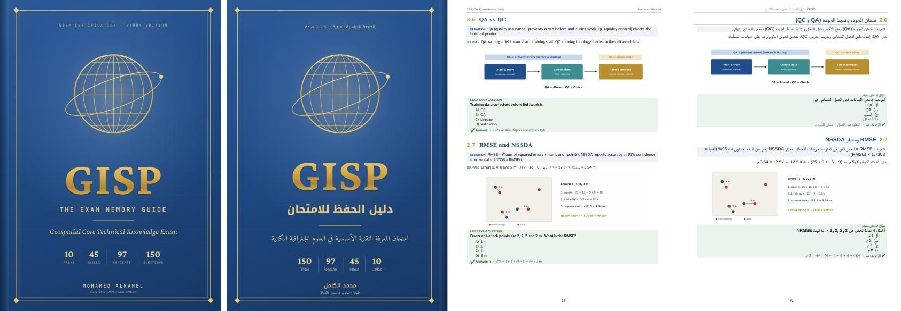

# GISP: The Exam Memory Guide · دليل الحفظ للامتحان

A plain-language study guide for the **GISCI Geospatial Core Technical Knowledge Exam** in two editions: **English** and **Arabic**. Both editions have the same content and the same page layout.

دليل دراسي مبسّط لامتحان **المعرفة التقنية الأساسية من GISCI** في نسختين: **إنجليزية** و**عربية**. النسختان متطابقتان في المحتوى والترتيب.



| | English | العربية |
|---|---|---|
| Word | [GISP_Exam_Memory_Guide_EN.docx](GISP_Exam_Memory_Guide_EN.docx) | [GISP_Exam_Memory_Guide_AR.docx](GISP_Exam_Memory_Guide_AR.docx) |
| PDF | [GISP_Exam_Memory_Guide_EN.pdf](GISP_Exam_Memory_Guide_EN.pdf) | [GISP_Exam_Memory_Guide_AR.pdf](GISP_Exam_Memory_Guide_AR.pdf) |

## What's inside · المحتوى

- **All 45 blueprint skills (KSAs)** of the 2019 exam blueprint, arranged in its 10 knowledge areas, with a coverage checklist.
- **97 concept cards.** Each card has the same four parts:
  1. A short definition.
  2. A direct example.
  3. A picture.
  4. A likely exam question with the answer.
- **For each area:**
  - The big idea in one sentence.
  - Memory tricks.
  - A keyword table: "if the question says… think…".
  - Traps to avoid.
  - A short self-test.
- **Review:**
  - Pairs people confuse.
  - Numbers and formulas.
  - A night-before page of 40 facts.
- **150 practice questions** with an answer key, weighted like the blueprint.
- **A glossary of 174 terms.** The Arabic edition gives each English term with its standard Arabic scientific equivalent.

**The Arabic edition:**

- It is a scientific translation, not a literal one. It keeps the English term in brackets the first time each term appears, because the exam is in English.
- The 150 practice questions stay in English on purpose. Their explanations in the answer key are in Arabic.

**النسخة العربية:**

- ترجمة علمية لا حرفية، مع ذكر المصطلح الإنجليزي بين قوسين عند أول ورود له، لأن الامتحان بالإنجليزية.
- أسئلة التدريب الـ150 بقيت بالإنجليزية عمداً، وشرح الإجابات في مفتاح الإجابات بالعربية.

## Rebuild · إعادة البناء

The source is in `source/`. You need Node.js with the `docx` package, and Python 3 with `matplotlib` and `scipy`.

The pictures:

```bash
cd source
python3 figs.py && python3 mini1.py && python3 mini2.py
```

The `.docx` files:

```bash
node build2.js       # English edition
node build_ar.js     # Arabic edition
```

The covers are HTML pages in `source/cover/`. They are rendered to images with Playwright (`shot.py`).

The `figs.py` and `mf_common.py` scripts write the pictures to an absolute folder, `/home/claude/notes/figs`. Change it to `figs` before running them anywhere else.

The contents-page numbers are filled in a second pass:

1. Convert the `.docx` to PDF.
2. Run `pages.py` for the English edition or `pages_ar.py` for the Arabic one.
3. Build the `.docx` again.

## Disclaimer · تنبيه

This is independent study material. It is **not affiliated with or endorsed by GISCI**. Every practice question was written for this guide, and **none is an official exam item**.

مادة دراسية مستقلة، غير تابعة لمعهد GISCI ولا معتمدة منه. أسئلة التدريب من تأليف الكاتب وليست أسئلة امتحان رسمية.

© 2026 Mohamed Alkamel · محمد الكامل
